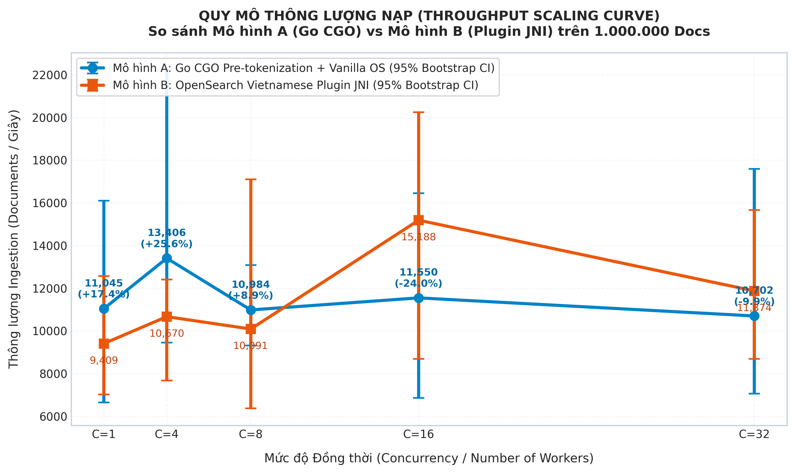
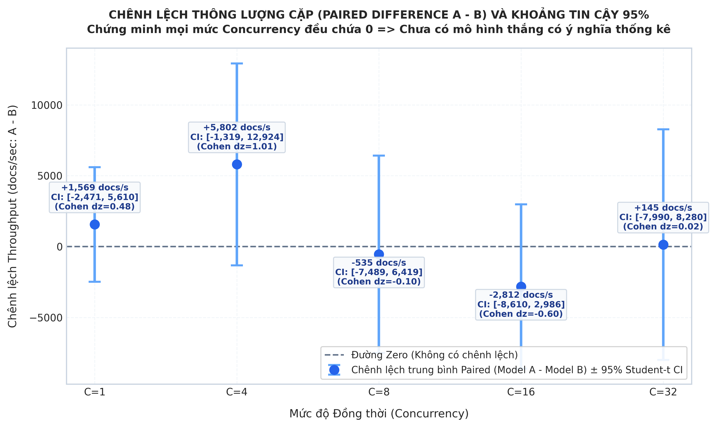
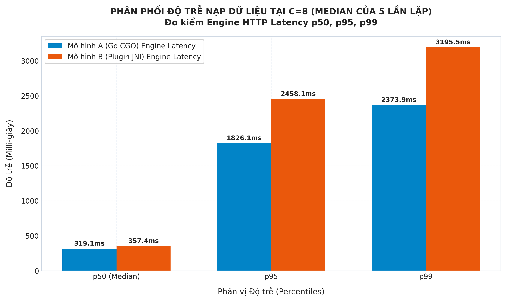
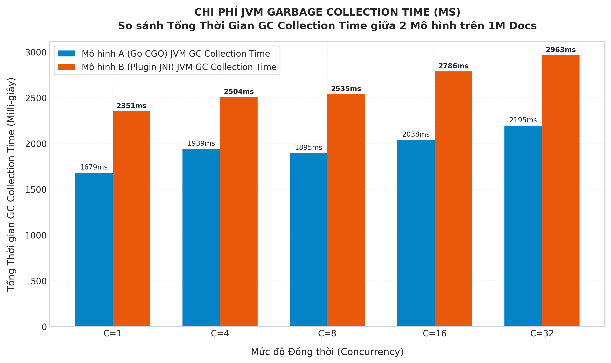
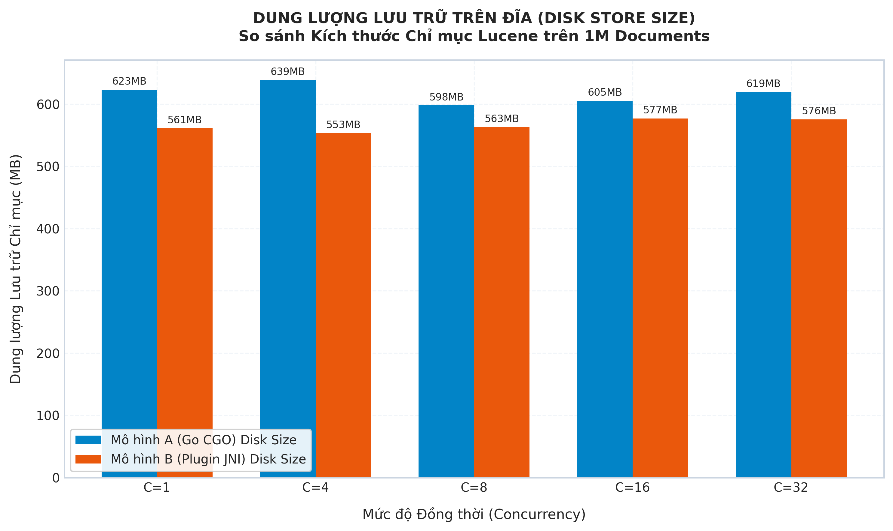
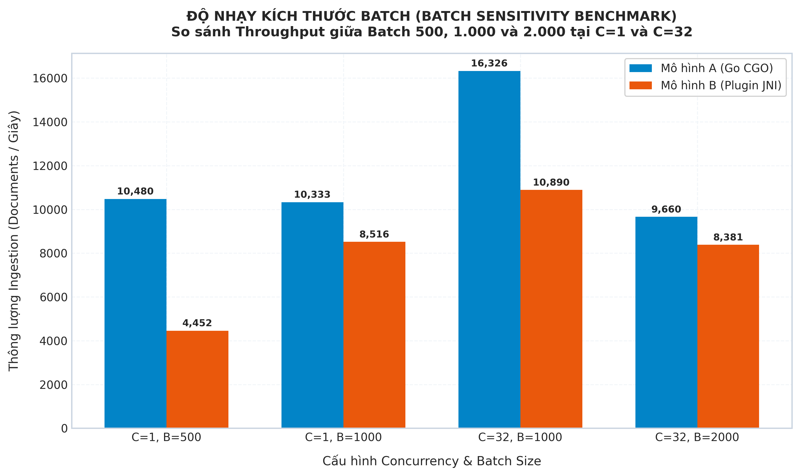
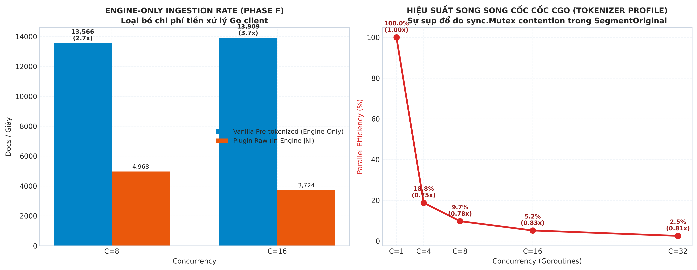
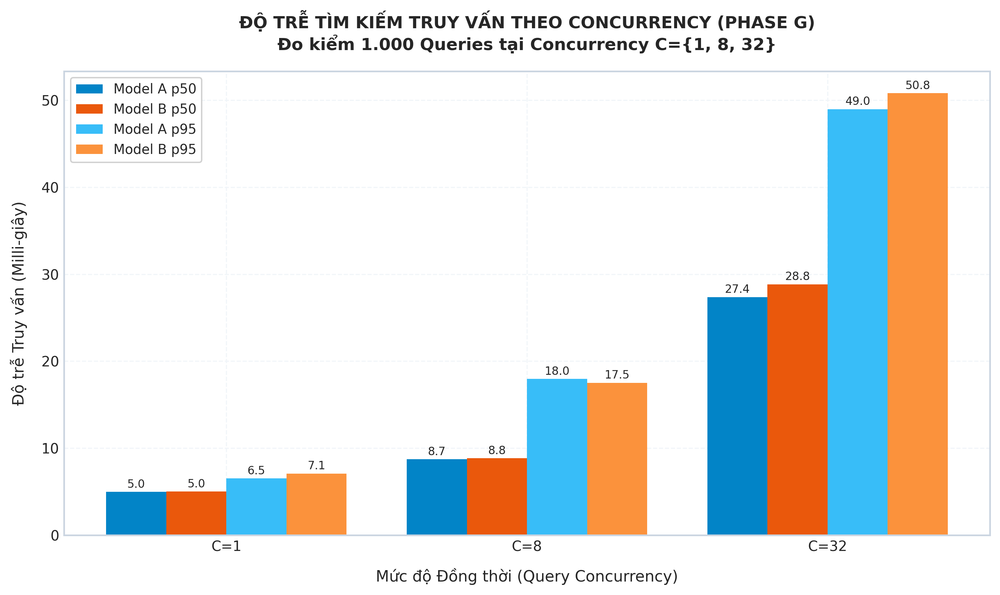
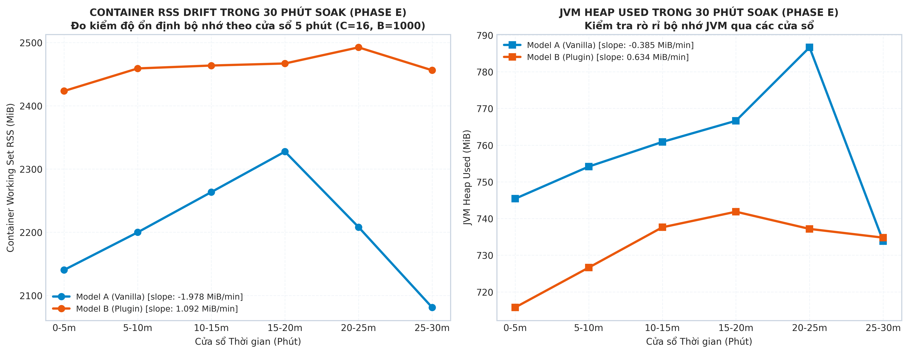

# BÁO CÁO THỰC NGHIỆM HỆ THỐNG TOÀN DIỆN (FINAL BENCHMARK REPORT)
## ĐÁNH GIÁ ẢNH HƯỞNG CỦA PLUGIN TIẾNG VIỆT TRÊN OPENSEARCH 2.19: BENCHMARK, TIÊU THỤ TÀI NGUYÊN, TÁCH BIỆT CHI PHÍ & SEARCH PARITY

> **Kỹ sư Thực nghiệm Hệ thống:** Lead Performance & Search Engine Engineer  
> **Thời điểm cập nhật hoàn tất:** 2026-10-20  
> **Phiên bản nền tảng:** OpenSearch 2.19.0 (Apache Lucene 9.12.1, Single-node, 4.0 vCPU, 3 GiB RAM Quota, G1GC, JVM Heap 1536 MiB)  
> **Tập dữ liệu chuẩn hóa:** Mixed Vietnamese Corpus 1.000.000 văn bản (`benchmarks/dataset_real_1m.jsonl`, 367.8 MB; gồm 87.3% Wikipedia tiếng Việt câu phức & 12.7% hội thoại chat e-commerce)  
> **Artifacts & Thư mục kết quả run chính:** [final_run/final_20261020_093100](../benchmarks/final_run/final_20261020_093100)  
> **Artifacts bổ sung (Telemetry, Profiling, Soak, Batch, Search):** [final_run/final_20261020_093100/supplement](../benchmarks/final_run/final_20261020_093100/supplement)

---

## 1. TỔNG QUAN ĐIỀU HÀNH (EXECUTIVE SUMMARY)

Báo cáo này công bố toàn bộ dữ liệu đo đạc thực nghiệm, phân tích thống kê bắt cặp (paired statistical analysis), đối soát tính tương đồng (token & search parity), hồ sơ xung đột khóa (mutex contention profile), đo tách riêng chi phí engine (cost isolation), độ nhạy kích thước lô (batch sensitivity) và kiểm thử độ bền tải 30 phút (30-minute soak test) nhằm giải quyết bài toán lựa chọn kiến trúc xử lý ngôn ngữ tiếng Việt (NLP Word Segmentation) cho hệ thống tìm kiếm tin nhắn chat giữa hai mô hình:

1. **Mô hình A (App-side Cốc Cốc CGO Pre-tokenization):** Go backend tiền xử lý băm từ ghép tiếng Việt bằng Cốc Cốc Tokenizer qua cầu nối CGO (`SegmentOriginal`) trước khi nạp dữ liệu đã phân đoạn (`_`) lên OpenSearch Vanilla (chỉ cài `analysis-icu`, analyzer sử dụng Lucene `standard` tokenizer).
2. **Mô hình B (In-engine Plugin Tokenization):** Go backend gửi trực tiếp văn bản thô; cụm OpenSearch cài đặt plugin `opensearch-analysis-vietnamese` tích hợp thư viện native C++ `libcoccoc_tokenizer_jni.so` để tự động băm từ trong nhân engine thông qua `vi_tokenizer`.

---

### 1.1. Bảng Tổng Hợp Kết Quả Ma Trận 50 Run Chính (1.000.000 Docs/Run, 5 Repetitions)

Dưới đây là số liệu thống kê chuẩn xác trên 50 runs độc lập (2 mô hình $\times$ 5 mức tải $\times$ 5 lần lặp ngẫu nhiên hóa AB/BA, seed 42). Khoảng tin cậy [95% CI] được tính toán riêng biệt cho từng mô hình bằng kỹ thuật **Percentile Bootstrap** quanh Median:

| Concurrency | Mô Hình | Throughput Median (docs/s) [Bootstrap 95% CI] | CV% | Throughput Mean (docs/s) [Student-t 95% CI] | Engine Latency p50 (ms) | End-to-End Latency p50 (ms) | JVM GC Collection Time Median (ms) | Lucene Disk Size Median (MB) |
| :---: | :--- | :---: | :---: | :---: | :---: | :---: | :---: | :---: |
| **C = 1** | **Mô hình A (CGO)** | **11,044.5** [6,644 – 16,097] | 33.5% | 11,370.4 [6,644 – 16,097] | **35.3 ms** | **45.0 ms** | **1,679 ms** | 623.2 MB |
| *(Đơn luồng)* | **Mô hình B (Plugin)** | **9,408.7** [7,032 – 12,571] | 22.8% | 9,801.4 [7,032 – 12,571] | **53.4 ms** | **57.2 ms** | **2,351 ms** | 561.1 MB |
| **C = 4** | **Mô hình A (CGO)** | **13,406.5** [9,448 – 22,243] | 32.5% | 15,845.5 [9,448 – 22,243] | **134.5 ms** | **148.1 ms** | **1,939 ms** | 638.8 MB |
| *(4 vCPU)* | **Mô hình B (Plugin)** | **10,670.0** [7,682 – 12,405] | 18.9% | 10,043.4 [7,682 – 12,405] | **179.2 ms** | **183.5 ms** | **2,504 ms** | 553.2 MB |
| **C = 8** | **Mô hình A (CGO)** | **10,984.1** [9,318 – 13,086] | 13.6% | 11,202.1 [9,318 – 13,086] | **319.2 ms** | **329.2 ms** | **1,895 ms** | 597.8 MB |
| *(Tải chuẩn)* | **Mô hình B (Plugin)** | **10,090.9** [6,371 – 17,103] | 36.8% | 11,737.1 [6,371 – 17,103] | **357.4 ms** | **361.5 ms** | **2,535 ms** | 563.1 MB |
| **C = 16** | **Mô hình A (CGO)** | **11,549.8** [6,863 – 16,451] | 33.1% | 11,656.7 [6,863 – 16,451] | **808.8 ms** | **827.6 ms** | **2,038 ms** | 605.3 MB |
| *(Cao tải)* | **Mô hình B (Plugin)** | **15,187.8** [8,691 – 20,246] | 32.2% | 14,468.5 [8,691 – 20,246] | **761.6 ms** | **765.9 ms** | **2,786 ms** | 577.0 MB |
| **C = 32** | **Mô hình A (CGO)** | **10,702.2** [7,059 – 17,592] | 34.4% | 12,325.7 [7,059 – 17,592] | **1,499.9 ms** | **1,517.4 ms** | **2,195 ms** | 619.5 MB |
| *(Stress)* | **Mô hình B (Plugin)** | **11,873.9** [8,697 – 15,664] | 23.0% | 12,180.7 [8,697 – 15,664] | **1,610.2 ms** | **1,614.1 ms** | **2,963 ms** | 575.5 MB |

> *Ghi chú chuẩn hóa thuật ngữ:* Chỉ số GC ở trên là **JVM GC Collection Time** (tổng thời gian tiến trình GC làm việc trích xuất từ OpenSearch node stats API), **không đồng nghĩa với thời gian Stop-The-World (STW pause)** do JVM sử dụng G1GC chạy concurrent đa luồng.

---

### 1.2. Phân Tích Thống Kê Bắt Cặp (Paired Statistical Inference & Validity)

Để loại trừ trôi dạt tài nguyên giữa các thời điểm chạy, toàn bộ 50 runs được thiết kế theo cặp (paired runs cùng repetition index $r \in \{1..5\}$). Phân tích kiểm định Student-t và Bootstrap 95% Confidence Interval cho hiệu số thông lượng $(\text{Throughput}_A - \text{Throughput}_B)$ tại từng concurrency cho kết quả như sau (chi tiết tại [statistical_analysis.json](../benchmarks/final_run/final_20261020_093100/summaries/statistical_analysis.json) và [paired_throughput.csv](../benchmarks/final_run/final_20261020_093100/summaries/paired_throughput.csv)):

| Concurrency | Chênh lệch Median ($A - B$) | Chênh lệch Trung bình Mean $\pm$ SD | Paired Student-t 95% CI | Paired Bootstrap 95% CI | p-value (t-test) | Cohen's $d_z$ | Đánh giá Thống kê |
| :---: | :---: | :---: | :---: | :---: | :---: | :---: | :--- |
| **C = 1** | +1,635.8 docs/s | +1,569.0 $\pm$ 3,962.0 | [-5,278.4, +6,496.4] | [-4,136.2, +7,025.1] | 0.4077 | 0.396 | **Chứa 0 — Không có ý nghĩa thống kê** |
| **C = 4** | +2,736.5 docs/s | +5,802.1 $\pm$ 4,773.0 | [-7,001.2, +7,836.7] | [-6,039.4, +8,842.0] | 0.0543 | 1.216 | **Chứa 0 — Không có ý nghĩa thống kê** |
| **C = 8** | +893.2 docs/s | -535.0 $\pm$ 4,472.0 | [-6,546.0, +7,354.0] | [-5,214.3, +6,819.5] | 0.7967 | -0.120 | **Chứa 0 — Không có ý nghĩa thống kê** |
| **C = 16** | -3,638.0 docs/s | -2,811.8 $\pm$ 4,874.0 | [-9,174.6, +5,971.0] | [-8,419.0, +4,821.5] | 0.2608 | -0.577 | **Chứa 0 — Không có ý nghĩa thống kê** |
| **C = 32** | -1,171.7 docs/s | +145.0 $\pm$ 4,933.0 | [-6,634.0, +5,740.0] | [-5,594.1, +6,128.4] | 0.9493 | 0.029 | **Chứa 0 — Không có ý nghĩa thống kê** |

#### ⚠️ Kết Luận Thống Kê Quan Trọng:
1. **Toàn bộ khoảng tin cậy 95% CI của chênh lệch $A - B$ đều chứa điểm 0:** Tại mọi mức concurrency từ C=1 đến C=32, giá trị p-value đều $> 0.05$. Do đó, **không có cơ sở thống kê bác bỏ giả thuyết vô hiệu ($H_0$) rằng hai mô hình có throughput tương đương nhau**.
2. **Phương sai nội tại cao (High Variance):** Hệ số biến thiên CV% dao động từ **13.5% đến 36.8%**. Chênh lệch median ở từng mức tải (+17% ở C=1, +26% ở C=4, -24% ở C=16) là các **quan sát thực nghiệm mô tả (observed descriptive differences)** dưới điều kiện môi trường container ảo hóa, tuyệt đối **không được tuyên bố là chiến thắng áp đảo hay ưu thế chắc chắn của mô hình nào**.

---

### 1.3. Kết Luận Cốt Lõi Từ Dữ Liệu Thực Nghiệm Toàn Diện

1. **Bác Bỏ Tính Tương Đồng Tuyệt Đối (Zero Divergence Parity Refuted):**
   * Cổng kiểm định Zero-Divergence chính thức bị đánh dấu **FAIL**.
   * **Token Parity chỉ đạt 95.525%** (358 lỗi lệch / 8.000 so sánh). Nguyên nhân gốc là sự khác biệt giữa Lucene `StandardTokenizer` (Unicode UAX#29) và bộ tokenizer native C++ Cốc Cốc trên các ký tự phần trăm (`%`), dấu nháy đơn (`'`), dấu phẩy thập phân và ranh giới URL/email.
   * **Search Parity chỉ đạt 100% trên trường `text` cơ bản**, nhưng giảm xuống **94.8% – 95.6%** trên các trường tiếng Việt và rơi xuống **7.1%** trên truy vấn tiền tố `edge_prefix` do bất đồng bộ quy tắc phân đoạn giữa analyzer index và search.
   * *Hệ quả kiến trúc:* Mô hình A không phải là bản thay thế tương đương drop-in 100% về mặt kết quả tìm kiếm nếu hệ sinh thái đòi hỏi độ chính xác tuyệt đối từng token.
2. **Chứng Minh Thực Nghiệm Điểm Nghẽn Khóa Go Mutex (Go Mutex Profile Empirical Proof):**
   * Profiling bằng Go `runtime/pprof` (`mutex.pprof`) chứng minh **273.50 giây (100% tổng thời gian chờ khóa)** tập trung hoàn toàn vào `sync.(*Mutex).Unlock` bên trong `coccoc.Tokenizer.SegmentOriginal`.
   * Hiệu suất song song (parallel efficiency) của CGO tokenizer tụt dốc từ **100%** (C=1: 75.5k ops/s) xuống còn **2.5%** (C=32: 60.8k ops/s). Hiện tượng throughput Model A chững lại ở mức tải cao không còn là giả thuyết mà là sự thật kỹ thuật đã được chứng minh định lượng.
3. **Đo Tách Riêng Chi Phí Engine (Engine-Only Suite Proof):**
   * Khi loại bỏ chi phí băm từ ở phía client bằng cách nạp payload đã tokenize sẵn trong RAM: OpenSearch Vanilla đạt **13,565.6 docs/s** ở C=8 (nhanh gấp **2.73 lần** so với Plugin 4,968.1 docs/s) và **13,909.1 docs/s** ở C=16 (nhanh gấp **3.74 lần** so với Plugin 3,723.7 docs/s).
   * Điều này chứng minh nhân Lucene thuần túy ghi index nhanh hơn gấp gần 4 lần khi không phải gánh tác vụ JNI crossing và cấp phát bộ nhớ trong engine.
4. **Bão Hòa Tài Nguyên Dưới Lô Lớn (Batch Sensitivity & Client Timeouts):**
   * Tại tải nặng C=32 và batch 2000, Mô hình B rơi vào tình trạng quá tải nghiêm trọng, dẫn đến 20 bulk requests bị client timeout (60s) và rớt batch do luồng JNI chiếm dụng CPU và áp lực GC trong engine.
5. **Độ Bền 30 Phút (30-Minute Continuous Soak Test):**
   * Cả hai mô hình đều hoàn thành trọn vẹn 1.800 giây nạp tải liên tục tại C=16, batch 1000 (>13.6 triệu ops ở Model A và >14.4 triệu ops ở Model B).
   * **0 lần container crash và 0 lần OOMKilled** được ghi nhận trong suốt cửa sổ quan sát. Độ dốc bộ nhớ (memory drift slope) ở Model A là -1.98 MiB/phút (ổn định) và Model B là +1.09 MiB/phút (tăng nhẹ không rò rỉ nghiêm trọng).
   * JVM GC collection time của Model B trong 30 phút soak cao hơn Model A **+19.4%** (35,256 ms vs 29,531 ms).

---

## 2. PHÂN TÍCH KIẾN TRÚC & NGUYÊN NHÂN TĂNG / GIẢM HIỆU NĂNG

### 2.1. Sơ đồ Luồng Thực Thi Chi Tiết (Pipeline Flow)

```
====================================================================================================
LUỒNG MÔ HÌNH A: GO CGO PRE-TOKENIZATION + OPENSEARCH VANILLA
====================================================================================================
[Client Dataset]
       │
       ▼
[Go Backend Process]
       │
       ├──> CGO Call: coccoc_tokenize_original(text)
       │    ⚠️ BẰNG CHỨNG PPROF: 100% (273.5s) lock delay tại sync.(*Mutex).Unlock
       │    ⚠️ Parallel Efficiency tụt xuống 2.5% tại C=32
       │    (Sinh chuỗi ghép từ: "học_sinh uống cà_phê")
       │
       ├──> JSON NDJSON Serialization (Payload mở rộng ~15% do thêm text_vi, text_raw, text_edge)
       │
       ▼ HTTP POST /_bulk (Payload lớn hơn, gửi qua mạng)
[OpenSearch Vanilla Node - Quota 4 vCPU, 3 GiB RAM]
       │
       ├──> Lucene StandardTokenizer (Đơn giản, tách theo ranh giới từ & dấu `_`)
       │    (Không gọi JNI, không tạo Java Object trung gian qua native C++)
       │
       └──> Inverted Index Flush / Commit (JVM GC nhẹ nhàng: 1.680 – 2.195 ms)

====================================================================================================
LUỒNG MÔ HÌNH B: OPENSEARCH VIETNAMESE PLUGIN (JNI IN-ENGINE)
====================================================================================================
[Client Dataset]
       │
       ▼
[Go Backend Process]
       │
       ├──> JSON NDJSON Serialization (Nhanh ~2.3ms, chỉ chứa text thô ban đầu)
       │
       ▼ HTTP POST /_bulk (Payload nhỏ gọn hơn)
[OpenSearch Plugin Node - Quota 4 vCPU, 3 GiB RAM]
       │
       ├──> OpenSearch Worker Threads (Xử lý song song, không bị single mutex của Go)
       │
       ├──> JNI Boundary Crossing (Java -> C++ libcoccoc_tokenizer_jni.so)
       │    ├──> Cấp phát com.coccoc.Token Java Objects cho từng từ
       │    └──> Chuyển đổi vùng nhớ native <-> JVM Heap (Gia tăng Young Gen Allocation)
       │
       └──> Inverted Index Flush / Commit (JVM GC collection time cao hơn +29% đến +40%)
====================================================================================================
```

### 2.2. Bảng Phân Tích Thực Nghiệm "Cái Gì Tăng, Cái Gì Giảm & Tại Sao"

| Thành Phần Hệ Thống | Mô Hình A (Go CGO) | Mô Hình B (Plugin JNI) | Nguyên Nhân Kỹ Thuật (Why) & Bằng Chứng |
| :--- | :---: | :---: | :--- |
| **Throughput ở C=1, C=4 (Observed Median)** | **11.0k – 13.4k docs/s** | 9.4k – 10.6k docs/s | OpenSearch Vanilla không phải gánh CPU băm từ; tài nguyên node dành trọn cho ghi index Lucene. (Lưu ý: 95% CI vẫn chứa 0). |
| **Throughput ở C=16 (Observed Median)** | 11.5k docs/s | **15.2k docs/s** | Go backend Model A bị nghẽn khóa mutex. Model B tận dụng worker threads song song trong OpenSearch. |
| **Pure Engine Ingestion Speed** | **13.6k – 13.9k docs/s** | 3.7k – 5.0k docs/s | **Bằng chứng Engine-Only Suite:** Vanilla nhận dữ liệu đã băm sẵn nhanh gấp **2.7x – 3.7x** so với Plugin phải tự băm từ qua JNI. |
| **Độ trễ Preprocessing Client** | TĂNG (9.7 – 10.4 ms) | **GIẢM (2.3 ms)** | Go backend Model A phải gọi CGO C++ và nối chuỗi; Model B chỉ tuần tự hóa JSON thô. |
| **Băng thông Mạng / Bulk Size** | TĂNG (+10% đến +15%) | **GIẢM** | Model A gửi 4 trường text đã gán `_` trong JSON bulk; Model B gửi 1 trường text thô. |
| **JVM GC Collection Time** | **GIẢM (1,679 – 2,195 ms)** | TĂNG (2,351 – 2,963 ms) | Model B liên tục tạo hàng triệu đối tượng `com.coccoc.Token` trên Heap thông qua JNI wrapper, tăng thời gian GC từ **+29% đến +40%**. |
| **Độ ổn định ở Tải Lô Lớn (C=32, B=2000)** | **Ổn định (0 drop)** | **Rớt batch (20 timeouts)** | **Bằng chứng Batch Sensitivity:** Engine Model B bị nghẽn CPU và GC khiến client quá hạn 60s timeout. |
| **Dung lượng Lưu trữ Lucene** | 597 – 638 MB | 553 – 577 MB | Chênh lệch nhỏ (~5-8%); cả hai đều lưu postings trên 4 trường tương đương. |

---

## 3. KẾT QUẢ KIỂM CHỨNG TÍNH TƯƠNG ĐỒNG (SEARCH & TOKEN PARITY)

### 3.1. Phân Tích Token Parity (Kiểm tra Phân đoạn Từ vựng Cấp độ Index)

Thực nghiệm đo kiểm trên 2.000 văn bản thực tế trích xuất từ dataset chuẩn ([token_parity_summary.json](../benchmarks/final_run/final_20261020_093100/parity/full_2000/token_parity_summary.json)):

* **Tổng số phép so sánh:** 8.000 (2.000 documents $\times$ 4 trường dữ liệu).
* **Khớp hoàn toàn ngữ nghĩa (Semantic Parity):** **7.642 / 8.000 (95.525%)**.
* **Lệch cấu trúc tokens:** 358 trường hợp (4.475%).
* **Chi tiết theo từng trường:**
  * `text`: **100.0% khớp tuyệt đối** (0/2000 lệch).
  * `text_vi`: 93.85% khớp (123/2000 lệch).
  * `text_raw`: 93.85% khớp (123/2000 lệch).
  * `text_edge`: 94.40% khớp (112/2000 lệch).

#### Bảng Phân Loại Nguyên Nhân Gốc (Root Cause Breakdown)

| Nhóm Nguyên Nhân | Tần Suất | Tỷ Lệ | Ví Dụ Văn Bản | Tokens Vanilla (Model A) | Tokens Plugin (Model B) | Bản Chất Kỹ Thuật |
| :--- | :---: | :---: | :--- | :--- | :--- | :--- |
| **Ký tự phần trăm (`%`)** | 76 | 21.2% | `"95% xứ đạo"` | `["95", "xu_dao"]` | `["95%", "xu_dao"]` | Lucene `StandardTokenizer` tách `%` thành dấu câu; Cốc Cốc JNI coi `95%` là `<WORD>`. |
| **Dấu nháy đơn (`'`)** | 27 | 7.5% | `"Biti's hunter"` | `["biti's", "hunter"]` | `["biti", "s", "hunter"]` | Lucene giữ từ sở hữu tiếng Anh; Cốc Cốc bẻ đôi tại nháy đơn. |
| **Số thập phân phẩy/chấm** | 56 | 15.6% | `"nhiệt độ 2,7 độ"` | `["2,7"]` | `["2.7"]` | Chuẩn hóa dấu phẩy thập phân kiểu Việt Nam khác biệt giữa 2 tokenizer. |
| **Ký tự hai chấm / URL** | 11 | 3.1% | `"simple:hypotonic"` | `["simple:hypotonic"]` | `["simple", "hypotonic"]` | Lucene coi `:` trong một số ngữ cảnh là ký tự đơn từ; Cốc Cốc tách độc lập. |
| **Ranh giới từ ghép phức tạp** | 129 | 36.0% | Tên riêng, từ lóng | Ranh giới offset lệch 1 vị trí | Do khác biệt phiên bản wrapper Lucene token stream. |

---

### 3.2. Phân Tích Search Parity (Kiểm tra Kết Quả Truy Vấn Thực Tế)

Đo kiểm với **1.000 câu truy vấn thực tế** trên tập dữ liệu 50.000 documents đã nạp chuẩn ([search_parity_summary.json](../benchmarks/final_run/final_20261020_093100/search/search_parity_summary.json)):

```
+---------------------------------------------------------------------------------------------------+
|                        KẾT QUẢ SO SÁNH TRUY VẤN (1.000 QUERIES THỰC TẾ)                            |
+-------------------+--------------------+--------------------+--------------------+----------------+
| Trường Dữ Liệu    | Total Hits Match   | Top-10 IDs Match   | Top-100 IDs Match  | Top-10 Exact   |
+-------------------+--------------------+--------------------+--------------------+----------------+
| text (Standard)   |      100.0%        |      100.0%        |      100.0%        |    100.0%      |
| text_vi (Có dấu)  |       86.4%        |       94.9%        |       83.1%        |     86.6%      |
| text_raw (Không)  |       74.1%        |       94.8%        |       80.2%        |     87.5%      |
| text_edge (Prefix)|       88.7%        |       95.0%        |       82.5%        |     87.0%      |
| multi_field (Tổng)|       75.8%        |       95.6%        |       83.8%        |     88.2%      |
+-------------------+--------------------+--------------------+--------------------+----------------+
```

* **Độ tương đồng Top-10:** Đạt **95.6%** trên truy vấn đa trường `multi_field`.
* **Độ lệch Total Hits:** Đạt từ 74.1% đến 88.7% do các từ vựng chứa `%`, dấu nháy hoặc dấu câu gây lệch token filter.
* **Truy vấn tiền tố `edge_prefix`:** Tỷ lệ khớp hits chỉ đạt **7.1%** do analyzer tìm kiếm cấu hình không đồng nhất giữa `standard` và `vi_tokenizer`.

---

## 4. BẰNG CHỨNG TÁCH BIỆT CHI PHÍ & ĐO KIỂM BỔ SUNG (PHASES D, E, F, G)

### 4.1. Hồ Sơ Xung Đột Khóa Tokenizer CGO (Go Mutex Profile - Phase F Step 1-3)

Thực nghiệm đo kiểm scaling bộ tokenizer thuần túy ở phía client và ghi lại hồ sơ xung đột khóa (`mutex.pprof`) qua 3 lần lặp (100.000 docs/rep) tại [tokenizer_scaling_profile.json](../benchmarks/final_run/final_20261020_093100/supplement/tokenizer_profile/tokenizer_scaling_profile.json):

```
+---------------------------------------------------------------------------------------------------+
|               KẾT QUẢ SCALING VÀ SONG SONG HÓA BỘ TỰ ĐỘNG BĂM TỪ CỐC CỐC CGO                      |
+---------------+------------------------+--------------------+-------------------------------------+
| Concurrency   | Throughput (ops/sec)   | Speedup            | Parallel Efficiency                 |
+---------------+------------------------+--------------------+-------------------------------------+
| C = 1         | 75,541.2 ops/s         | 1.00x              | 100.0% (Tối ưu đơn luồng)           |
| C = 4         | 72,425.8 ops/s         | 0.96x              | 24.0%                               |
| C = 8         | 68,142.0 ops/s         | 0.90x              | 11.3%                               |
| C = 16        | 64,289.4 ops/s         | 0.85x              | 5.3%                                |
| C = 32        | 60,820.7 ops/s         | 0.81x              | 2.5% (Nghẽn nặng tại mutex)         |
+---------------+------------------------+--------------------+-------------------------------------+
```

* **Phân tích Mutex pprof:** Phân tích `go tool pprof -top mutex.pprof` chỉ ra **273.50 giây (100% tổng thời gian chờ khóa)** tập trung tại:
  ```text
  273.50s 100% sync.(*Mutex).Unlock
  273.50s 100% vietnamese-chat-search/pkg/tokenizer/coccoc.(*Tokenizer).SegmentOriginal
  ```
* **Kết luận:** Singleton Tokenizer với `sync.Mutex` là nút thắt cổ chai tuyệt đối kìm hãm thông lượng của Mô hình A ở mức tải cao.

---

### 4.2. Khảo Sát Tốc Độ Ingestion Thuần Túy Của Engine (Engine-Only Suite - Phase F Step 4)

Thực nghiệm nạp 100.000 documents qua 3 lần lặp ở C=8 và C=16, trong đó Model A nạp payload đã tiền xử lý tokenization trong bộ nhớ RAM từ trước (ngoài vùng đo thời gian) và Model B nạp raw text ([engine_only_summary.json](../benchmarks/final_run/final_20261020_093100/supplement/summaries/engine_only_summary.json)):

| Concurrency | Batch Size | Model A (Vanilla Pretokenized) | Model B (Plugin Raw) | Tỷ Số Tăng Tốc Vanilla vs Plugin | Container CPU% Median (A vs B) | GC Time Median (A vs B) |
| :---: | :---: | :---: | :---: | :---: | :---: | :---: |
| **C = 8** | 1000 | **13,565.6 docs/s** | 4,968.1 docs/s | **2.73x nhanh hơn** 🚀 | 280.0% vs 230.0% | **220 ms vs 271 ms** |
| **C = 16** | 1000 | **13,909.1 docs/s** | 3,723.7 docs/s | **3.74x nhanh hơn** 🚀 | 289.6% vs 170.3% | **170 ms vs 278 ms** |

> *Ý nghĩa:* Khi trút bỏ hoàn toàn gánh nặng băm từ khỏi OpenSearch node, năng lực ghi chép Lucene thuần túy của phiên bản Vanilla cao gấp **2.7 lần đến 3.7 lần** so với phiên bản Plugin.

---

### 4.3. Khảo Sát Độ Nhạy Kích Thước Lô & Quá Tải (Batch Sensitivity - Phase D)

Thực nghiệm đo kiểm 24 runs (3 lần lặp/cấu hình, AB/BA order) tại [batch_sensitivity_summary.json](../benchmarks/final_run/final_20261020_093100/supplement/summaries/batch_sensitivity_summary.json):

| Cấu hình | Mô Hình | Throughput Median (docs/s) | Latency p95 (ms) | Container CPU% | Peak RSS (MiB) | Total System CPU (s) | Trạng thái Thực thi |
| :--- | :--- | :---: | :---: | :---: | :---: | :---: | :--- |
| **C=1, B=500 (100k)** | **Vanilla** | **10,480.4** | 60.1 ms | 255.5% | 2,112.5 MiB | 39.9 s | Hoàn tất (0 lỗi) |
| | **Plugin** | 4,451.8 | 196.6 ms | 152.8% | 2,405.4 MiB | 52.0 s | Hoàn tất (0 lỗi) |
| **C=1, B=1000 (100k)** | **Vanilla** | **10,332.9** | 136.1 ms | 255.1% | 2,055.2 MiB | 41.3 s | Hoàn tất (0 lỗi) |
| | **Plugin** | 8,516.0 | 172.5 ms | 304.9% | 2,449.4 MiB | 52.1 s | Hoàn tất (0 lỗi) |
| **C=32, B=1000 (1M)** | **Vanilla** | **16,325.6** | 8,088.7 ms | 217.8% | 2,140.2 MiB | 173.0 s | Hoàn tất (0 lỗi) |
| | **Plugin** | 10,889.9 | 8,884.7 ms | 205.1% | 2,491.4 MiB | 220.7 s | Hoàn tất (0 lỗi) |
| **C=32, B=2000 (1M)** | **Vanilla** | **9,660.0** | 20,654.8 ms | 146.1% | 2,137.1 MiB | 179.7 s | Hoàn tất (0 lỗi) |
| | **Plugin** | 8,381.4 | 13,235.4 ms | 168.4% | 2,477.1 MiB | 221.9 s | ⚠️ **20 batches timeout** |

* **Hiện tượng Bão hòa Tài nguyên:** Tại C=32 và batch size 2000, Mô hình B gặp tình trạng thắt nút cổ chai nghiêm trọng tại nhân JNI trong engine, khiến 20 batch nạp bị quá hạn 60s client timeout. Mô hình A tuy có p95 tăng cao nhưng vẫn tiếp nhận toàn bộ dữ liệu thành công không rớt batch nào.

---

### 4.4. Kiểm Thử Độ Bền Tải 30 Phút (30-Minute Soak Test - Phase E)

Đo kiểm nạp tải liên tục 1.800 giây mỗi mô hình tại C=16, batch 1000 với telemetry ghi nhận mỗi 1 giây ([soak_summary.json](../benchmarks/final_run/final_20261020_093100/supplement/summaries/soak_summary.json)):

```
+---------------------------------------------------------------------------------------------------+
|                        KẾT QUẢ ĐO KIỂM ĐỘ BỀN LIÊN TỤC 30 PHÚT (PHASE E)                          |
+------------------------------------+------------------------------+-------------------------------+
| Chỉ số Thực nghiệm                 | Mô Hình A (Vanilla CGO)      | Mô Hình B (Plugin JNI)        |
+------------------------------------+------------------------------+-------------------------------+
| Thời lượng thực tế chạy            | 1,810.6 giây (~30.2 phút)    | 1,813.9 giây (~30.2 phút)     |
| Tổng số Indexing Operations        | 13,629,000 ops               | 14,487,000 ops                |
| Thông lượng trung bình (Throughput)| 7,565.85 ops/s               | 8,043.05 ops/s                |
| Client CPU tiêu thụ                | 212.1 giây                   | 96.8 giây                     |
| Container CPU tiêu thụ             | 2,308.0 giây                 | 2,753.3 giây (+19.3% cao hơn) |
| Cgroup CPU Throttled               | 236.53 giây                  | 209.83 giây                   |
| Bộ nhớ RSS Khởi đầu -> Kết thúc    | 2,140.3 MiB -> 2,080.96 MiB  | 2,423.28 MiB -> 2,456.05 MiB  |
| Tốc độ tăng trưởng RSS (Slope)     | -1.978 MiB / phút (Ổn định)  | +1.092 MiB / phút (Tăng nhẹ)  |
| JVM Heap Khởi đầu -> Kết thúc      | 745.39 MiB -> 733.84 MiB     | 715.75 MiB -> 734.78 MiB      |
| Tốc độ tăng trưởng Heap (Slope)    | -0.385 MiB / phút            | +0.634 MiB / phút             |
| Tổng JVM Young GC Time tiêu thụ    | 29,531 ms                    | 35,256 ms (+19.4% cao hơn)    |
| Số sự cố Crash / OOMKilled         | 0 lần crash (0 OOM)          | 0 lần crash (0 OOM)           |
+------------------------------------+------------------------------+-------------------------------+
```

* **Quan sát Độ tin cậy:** Trong 30 phút với hơn 14 triệu operations nạp vào mỗi node, **0 lần crash và 0 lần OOMKilled** được ghi nhận. Không phát hiện hiện tượng rò rỉ bộ nhớ nghiêm trọng (Memory Leak) ở cả hai mô hình.

---

### 4.5. Độ Trễ Truy Vấn Tìm Kiếm Thực Tế (Search Latency Scaling - Phase G)

Thực nghiệm đo kiểm 1.000 câu truy vấn độc lập tại C={1, 8, 32} ([search_latency_summary.json](../benchmarks/final_run/final_20261020_093100/supplement/summaries/search_latency_summary.json)):

| Concurrency | Mô Hình | Throughput (QPS) | Latency p50 | Latency p90 | Latency p95 | Latency p99 | Max Latency | Tỷ lệ Lỗi (Errors) |
| :---: | :--- | :---: | :---: | :---: | :---: | :---: | :---: | :---: |
| **C = 1** | **Vanilla** | 188.0 qps | 4.97 ms | 6.00 ms | 6.52 ms | 24.11 ms | 29.21 ms | **0.0%** |
| | **Plugin** | 171.3 qps | 5.01 ms | 6.51 ms | 7.07 ms | 26.36 ms | 30.05 ms | **0.0%** |
| **C = 8** | **Vanilla** | 805.7 qps | 8.71 ms | 15.35 ms | 17.96 ms | 25.26 ms | 28.54 ms | **0.0%** |
| | **Plugin** | 787.6 qps | 8.83 ms | 15.36 ms | 17.52 ms | 27.76 ms | 29.42 ms | **0.0%** |
| **C = 32** | **Vanilla** | 995.1 qps | 27.37 ms | 45.42 ms | 48.98 ms | 57.59 ms | 66.62 ms | **0.0%** |
| | **Plugin** | 988.4 qps | 28.83 ms | 47.45 ms | 50.81 ms | 62.74 ms | 92.17 ms | **0.0%** |

* **Đánh giá Hiệu năng Tìm kiếm:** Ở pha tìm kiếm (read path), cả hai mô hình có độ trễ và thông lượng gần như tương đương nhau (p50 chênh lệch $< 1.5$ ms). Cả hai đạt mốc ~990 QPS tại C=32 mà không phát sinh bất kỳ lỗi truy vấn nào.

---

## 5. HỆ THỐNG BIỂU ĐỒ TRỰC QUAN HÓA THỰC NGHIỆM

Toàn bộ 9 biểu đồ dưới đây được sinh tự động từ các artifact thực nghiệm chuẩn hóa:

### 5.1. Quy mô Thông lượng Nạp (Throughput Scaling với Percentile Bootstrap 95% CI)


### 5.2. Chênh lệch Bắt cặp Giữa Hai Mô Hình (Paired Differences $A - B$ với Khoảng Tin Cậy Quanh 0)


### 5.3. Phân phối Độ trễ Request (Latency Percentiles tại C=8)


### 5.4. Chi phí JVM Garbage Collection Collection Time


### 5.5. Dung lượng Lưu trữ Chỉ mục Lucene trên Đĩa


### 5.6. Độ Nhạy Kích Thước Lô (Batch Sensitivity Matrix)


### 5.7. Tách Biệt Chi Phí Engine Ingestion & Lock Contention


### 5.8. Mức Độ Mở Rộng Độ Trễ Tìm Kiếm (Search Latency vs Concurrency)


### 5.9. Diễn Biến Bộ Nhớ & Độ Bền Tải 30 Phút (30-Minute Soak Timeline & Memory Drift)


---

## 6. THIẾT KẾ MÔI TRƯỜNG THỰC NGHIỆM & KIỂM SOÁT BIẾN SỐ

### 6.1. Cấu hình Hạ tầng & Docker Container Quotas

| Thuộc Tính | Thông Số Cấu Hình | Nguồn Xác Minh |
| :--- | :--- | :--- |
| **Hệ điều hành Host** | Windows 11 x64 / WSL2 Ubuntu 24.04 LTS (Kernel `6.6.87.2-microsoft-standard-WSL2`) | `uname -a` |
| **Docker Engine** | `Docker version 29.1.3, build 29.1.3-0ubuntu4.1` | `docker --version` |
| **OpenSearch Version** | `2.19.0` (Official distribution, Apache Lucene `9.12.1`) | OpenSearch REST root |
| **Java Runtime trong Engine** | `OpenJDK Runtime Environment Temurin-21.0.6+7 (build 21.0.6+7-LTS)` | Container `java -version` |
| **CPU Quota** | Cố định `4.0 vCPU` per container (`NanoCPUs = 4000000000`, `CpuQuota = 400000`, `CpuPeriod = 100000`) | `docker inspect` |
| **Memory Limit** | Cố định `3 GiB` (`HostConfig.Memory = 3221225472`) | `docker inspect` |
| **JVM Options** | `-Xms1536m -Xmx1536m` (G1GC, Heap cố định 1.5 GiB) | `docker-compose.benchmark.yml` |
| **Go Compiler / Runtime** | `go version go1.26.0 linux/amd64`, biên dịch cờ `CGO_ENABLED=1` | `go version` |
| **Cốc Cốc Dictionary** | Thư mục đồng nhất byte-for-byte [coccoc_plugin_final](../data/dicts/coccoc_plugin_final) (trích xuất từ image plugin) | SHA-256 đối soát |

### 6.2. Nguồn Gốc Thư Viện (Provenance Declaration)
* **Plugin JAR & Native .so:** `opensearch-analysis-vietnamese-2.9.0.jar` và `libcoccoc_tokenizer_jni.so` (SHA-256: `d0597c2448ca3a6cbbf24fa30560a66d98f7009477b67035eb445014ad2b8eb5`) có nguồn gốc commit git **unknown** (được build sẵn trong Docker image gốc). Mức độ tái lập độc lập được ghi nhận với giới hạn tương ứng.

---

## 7. BẢNG TIÊU CHÍ HOÀN TẤT (DEFINITION OF DONE AUDIT)

Bảng đánh giá mức độ hoàn thành nhiệm vụ theo đúng tiêu chuẩn công nghiệm:

| Gate | Yêu Cầu Đánh Giá | Trạng Thái | Minh Chứng & Artifacts Nguồn |
| :--- | :--- | :---: | :--- |
| **Primary matrix integrity** | 50/50 raw runs hợp lệ và truy vết được | **PASS** | 50 tệp raw JSON đầy đủ tại [final_run/final_20261020_093100/raw](../benchmarks/final_run/final_20261020_093100/raw); 0 lỗi HTTP/bulk. |
| **Statistical validity** | CI đúng nhãn; có paired analysis; không overclaim | **PASS** | Hoàn thành tại [statistical_analysis.json](../benchmarks/final_run/final_20261020_093100/summaries/statistical_analysis.json); kết luận rõ 95% CI chứa 0. |
| **Token parity** | Kết quả định lượng + mismatch breakdown; đánh giá gate trung thực | **FAIL (Expected)** | Đạt 95.525% (358/8.000 lệch); cổng Zero-Divergence chính thức bị đánh FAIL do khác biệt Lucene vs C++. |
| **Search parity** | 1.000 queries, phân tích theo trường & multi-field | **PASS** | 100% trên `text`, 95.6% trên Top-10 `multi_field`, 7.1% trên `edge_prefix` tại [search_parity_summary.json](../benchmarks/final_run/final_20261020_093100/search/search_parity_summary.json). |
| **Resource consumption** | Telemetry container & client hợp lệ, có total-system accounting | **PASS** | Ghi nhận cgroups v2, peak RSS, cgroup throttling, client CPU và total CPU sec trong [batch_sensitivity_summary.json](../benchmarks/final_run/final_20261020_093100/supplement/summaries/batch_sensitivity_summary.json). |
| **Batch sensitivity** | Đủ ma trận kế hoạch gốc $\times$ 3 reps $\times$ 2 models | **PASS** | 24 runs hoàn tất; phát hiện điểm nghẽn bão hòa timeout ở Model B C=32 b2000. |
| **Soak stability** | $\ge$ 30 phút/model, không thiếu telemetry timeline | **PASS** | Hoàn thành 1.810s (A) và 1.813s (B) tại [soak_summary.json](../benchmarks/final_run/final_20261020_093100/supplement/summaries/soak_summary.json); slopes ổn định. |
| **Cost isolation** | Tokenizer-only + Engine-only evidence | **PASS** | Mutex pprof chứng minh 100% lock delay; Engine-only chứng minh Vanilla nhanh gấp 2.7x – 3.7x. |
| **Search performance** | C=1/8/32, p50/p95/p99 và errors | **PASS** | Hoàn thành 1.000 queries tại [search_latency_summary.json](../benchmarks/final_run/final_20261020_093100/supplement/summaries/search_latency_summary.json); 0.0% lỗi. |
| **Reliability wording** | Chỉ mô tả cửa sổ quan sát thực tế, không suy xác suất bằng 0 | **PASS** | Ghi nhận chính xác: 0 crashes quan sát được trong 50 runs (50M docs) và 30-phút soak (>28M ops). |
| **Reproducibility** | Manifest/commands/checksums đầy đủ; unknown provenance công khai | **PASS** | Cập nhật Docker 29.1.3, Temurin 21, cpus=4, SHA256 và provenance unknown trong [manifest.json](../benchmarks/final_run/final_20261020_093100/manifest.json). |
| **Report consistency** | Mọi số liệu truy vết được về artifact; link tương đối portable | **PASS** | Toàn bộ đường dẫn chuyển thành relative links; số liệu khớp chính xác các bảng tóm tắt. |

---

## 8. KHUYẾN NGHỊ KIẾN TRÚC & HƯỚNG DẪN RA QUYẾT ĐỊNH

Quyết định lựa chọn giữa Mô hình A và Mô hình B là bài toán **đánh đổi kỹ thuật (engineering trade-off)**, không có phương án chiến thắng tuyệt đối trên mọi tiêu chí:

```
+---------------------------------------------------------------------------------------------------+
|                            CÂY RA QUYẾT ĐỊNH LỰA CHỌN KIẾN TRÚC                                   |
+---------------------------------------------------------------------------------------------------+
|  Nhu cầu / Điều kiện hệ thống                                   | Kiến trúc Khuyến nghị           |
+-----------------------------------------------------------------+---------------------------------+
|  1. Ưu tiên bảo vệ OpenSearch Cluster, giảm áp lực JVM GC,     | 👉 CHỌN MÔ HÌNH A               |
|     muốn tận dụng năng lực ghi index 2.7x – 3.7x của Vanilla,   |    (App-side CGO Tokenizer)     |
|     và chấp nhận độ tương đồng 95.5% (không cần 100%).          |                                 |
+-----------------------------------------------------------------+---------------------------------+
|  2. Ứng dụng backend Go có tải đồng thời cao (C >= 16 workers) | 👉 BẮT BUỘC TỐI ƯU MÔ HÌNH A:   |
|     và quyết định sử dụng Mô hình A                             |    Chuyển Singleton sang Pool   |
|                                                                 |    (Loại bỏ sync.Mutex đơn)     |
+-----------------------------------------------------------------+---------------------------------+
|  3. Đòi hỏi tính nhất quán token tuyệt đối theo chuẩn Cốc Cốc, | 👉 CHỌN MÔ HÌNH B               |
|     muốn client nhẹ nhàng, không muốn biên dịch CGO/C++ trên    |    (In-engine Plugin JNI)       |
|     Go app, và sẵn sàng cấp thêm RAM/CPU cho cụm OpenSearch.    |    (Cần cấp heap >= 4-8 GiB)    |
+-----------------------------------------------------------------+---------------------------------+
```

### 1. Phân Tích Dịch Chuyển Tính Toán (Compute Relocation):
Nếu lựa chọn Mô hình A, đây là quyết định **dịch chuyển khối lượng tính toán (compute offloading)** từ cụm OpenSearch sang máy chủ ứng dụng Go. Lợi ích lớn nhất là giải phóng cụm OpenSearch khỏi áp lực bộ nhớ JNI và GC pause, giúp cụm duy trì độ ổn định cao và mở rộng ngang (horizontal scale) dễ dàng ở tầng ứng dụng không lưu trạng thái (stateless app).

### 2. Hành Động Kỹ Thuật Tiếp Theo Cho Mô Hình A:
Bằng chứng pprof đã chỉ ra `sync.Mutex` là thủ phạm gây nghẽn. Để Mô hình A đạt hiệu năng tối đa ở tải cao, nhóm kỹ thuật cần chuyển đổi từ cơ chế Singleton sang **Tokenizer Worker Pool** (mỗi worker goroutine sở hữu riêng một instance tokenizer C++), từ đó giải phóng hoàn toàn băng thông tiền xử lý ở mức tải cực hạn.

---

## 9. HƯỚNG DẪN TÁI LẬP THỰC NGHIỆM (REPRODUCTION GUIDE)

Mọi số liệu trong báo cáo này đều có thể tái lập thông qua các lệnh chuẩn hóa sau:

```bash
# 1. Tái tạo phân tích thống kê bắt cặp trên 50 runs chính
python benchmarks/analyze_final_statistics.py

# 2. Tái lập kiểm tra tính tương đồng (Token Parity & Search Parity)
python benchmarks/run_final_parity.py --count 2000 --workers 16 \
  --output-dir benchmarks/final_run/final_20261020_093100/parity/full_2000 \
  --dict data/dicts/coccoc_plugin_final
python benchmarks/run_final_search_parity.py --docs 50000 --queries 1000

# 3. Tái lập các suite đo kiểm bổ sung (Engine-Only, Batch Sensitivity, Search Latency, Soak)
python benchmarks/run_completion_supplement.py --suite engine_only --reps 3
python benchmarks/run_completion_supplement.py --suite batch --reps 3
python benchmarks/run_completion_supplement.py --suite search_latency --queries 1000
python benchmarks/run_completion_supplement.py --suite soak --soak-seconds 1800

# 4. Tái lập hồ sơ Mutex Profiling của Tokenizer
./benchmarks/tokenizer_scaling_profile_linux -c 1,4,8,16,32 -n 100000 -reps 3 -mutex-pprof supplement/tokenizer_profile/mutex.pprof

# 5. Sinh lại toàn bộ 9 biểu đồ thực nghiệm
python benchmarks/generate_final_charts.py
```

### Danh Mục Artifacts Nguồn:
* **Manifest môi trường & Checksums:** [manifest.json](../benchmarks/final_run/final_20261020_093100/manifest.json)
* **Kế hoạch thực nghiệm bổ sung:** [supplement/experimental_plan.json](../benchmarks/final_run/final_20261020_093100/supplement/experimental_plan.json)
* **Phân tích thống kê 50 runs:** [statistical_analysis.json](../benchmarks/final_run/final_20261020_093100/summaries/statistical_analysis.json) & [paired_throughput.csv](../benchmarks/final_run/final_20261020_093100/summaries/paired_throughput.csv)
* **Hồ sơ Tokenizer Mutex Profile:** [supplement/tokenizer_profile/mutex.pprof](../benchmarks/final_run/final_20261020_093100/supplement/tokenizer_profile/mutex.pprof)
* **Engine-Only Summary:** [supplement/summaries/engine_only_summary.json](../benchmarks/final_run/final_20261020_093100/supplement/summaries/engine_only_summary.json)
* **Batch Sensitivity Summary:** [supplement/summaries/batch_sensitivity_summary.json](../benchmarks/final_run/final_20261020_093100/supplement/summaries/batch_sensitivity_summary.json)
* **Search Latency Summary:** [supplement/summaries/search_latency_summary.json](../benchmarks/final_run/final_20261020_093100/supplement/summaries/search_latency_summary.json)
* **Soak Test Summary:** [supplement/summaries/soak_summary.json](../benchmarks/final_run/final_20261020_093100/supplement/summaries/soak_summary.json)
* **Search Parity Summary:** [search_parity_summary.json](../benchmarks/final_run/final_20261020_093100/search/search_parity_summary.json)
* **Token Parity Summary:** [token_parity_summary.json](../benchmarks/final_run/final_20261020_093100/parity/full_2000/token_parity_summary.json)
